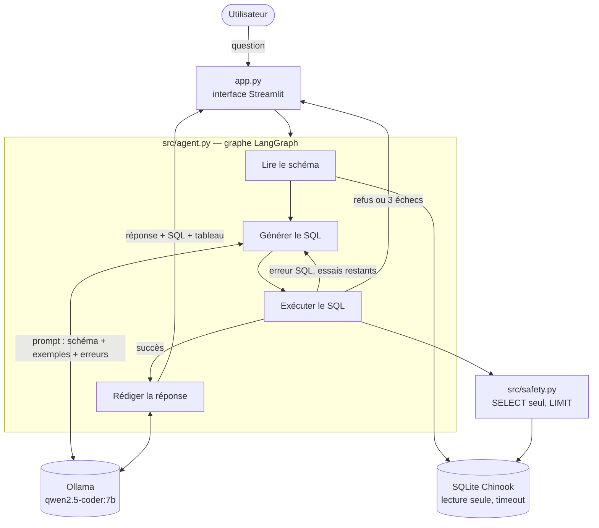

# nl-to-sql-agent

[](https://github.com/martin76400/nl-to-sql-agent/actions/workflows/ci.yml)

Pose une question en français ou en anglais, l'agent écrit la requête SQL, l'exécute sur une base SQLite et te répond en langage naturel.

Tout tourne en local : LangChain + LangGraph pour l'orchestration, Ollama pour le modèle (`qwen2.5-coder:7b` par défaut), Streamlit pour l'interface. Aucune clé API, aucun service payant.

```text
Question : Quels sont les 3 artistes qui ont le plus d'albums ?

SQL      : SELECT Artist.Name, COUNT(*) AS NbAlbums
           FROM Artist JOIN Album ON Artist.ArtistId = Album.ArtistId
           GROUP BY Artist.ArtistId ORDER BY NbAlbums DESC LIMIT 3

Réponse  : Les 3 artistes qui ont le plus d'albums sont :
           - Iron Maiden avec 21 albums
           - Led Zeppelin avec 14 albums
           - Deep Purple avec 11 albums
```

La base de démonstration est [Chinook](https://github.com/lerocha/chinook-database) : un magasin de musique en ligne (artistes, albums, pistes, clients, factures).

## Architecture



Le chemin d'une question :

1. **Lire le schéma** : l'agent interroge SQLite et produit une ligne par table, avec les clés étrangères.
2. **Générer le SQL** : le modèle reçoit le schéma, sept exemples question → SQL et la question.
3. **Exécuter** : la requête passe par les garde-fous, puis s'exécute en lecture seule.
4. **Corriger** : si SQLite renvoie une erreur, elle est renvoyée au modèle, qui réessaie (3 essais au maximum).
5. **Répondre** : le modèle rédige une phrase à partir du résultat.

Pour comprendre le code en détail, lis [LEARNING.md](LEARNING.md).

## Installation

Prérequis : Python 3.11 ou plus, et [Ollama](https://ollama.com/download) lancé.

```bash
git clone https://github.com/martin76400/nl-to-sql-agent.git
cd nl-to-sql-agent

python3 -m venv .venv
source .venv/bin/activate
pip install -r requirements.txt

ollama pull qwen2.5-coder:7b          # 4,7 Go
python scripts/download_chinook.py    # base de démo, 1 Mo

cp .env.example .env                  # facultatif : pour changer de modèle
```

Le fichier `.env` accepte deux variables :

| Variable | Valeur par défaut | Rôle |
|---|---|---|
| `OLLAMA_MODEL` | `qwen2.5-coder:7b` | Modèle utilisé pour le SQL et la réponse |
| `OLLAMA_BASE_URL` | `http://localhost:11434` | Adresse du serveur Ollama |

## Usage

```bash
streamlit run app.py                                   # interface web
python -m src.agent "Quel genre génère le plus de revenus ?"   # agent, en ligne de commande
python -m src.chain "Combien y a-t-il d'artistes ?"    # chaîne simple, sans réessai
python eval/run_eval.py                                # évaluation
pytest                                                 # tests (sans Ollama)
```

L'interface affiche la réponse, le SQL généré, le tableau de résultats, l'historique de la session et, s'il y en a, les essais ratés. La première question est plus lente (une quinzaine de secondes), le temps qu'Ollama charge le modèle en mémoire ; les suivantes prennent quelques secondes.

## Garde-fous

Le modèle n'est jamais cru sur parole. Toute requête passe par `db.run_query`, qui applique quatre protections :

| Protection | Où | Effet |
|---|---|---|
| Lecture seule | `src/db.py` | La connexion SQLite est ouverte en `mode=ro` : SQLite refuse toute écriture |
| Validation | `src/safety.py` | Une seule instruction, `SELECT` ou `WITH` uniquement, pas de `DROP`, `DELETE`, `UPDATE`, `INSERT`, `ALTER`, etc. |
| `LIMIT` par défaut | `src/safety.py` | `LIMIT 200` ajouté aux requêtes qui n'en ont pas |
| Timeout | `src/db.py` | Requête interrompue après 5 secondes |

## Score d'évaluation

| Modèle | Facile | Moyen | Difficile | Exactitude |
|---|---|---|---|---|
| `qwen2.5-coder:7b` | 5/5 | 5/5 | 5/5 | **15/15 (100 %)** |

Mesuré avec `python eval/run_eval.py` sur les 15 questions de [eval/questions.json](eval/questions.json) ; le détail est dans [eval/results.json](eval/results.json). On compare les résultats renvoyés, pas le texte des requêtes. Une des 15 questions (la n° 13) n'a réussi qu'au deuxième essai, grâce à la boucle de correction.

Ce score est à lire avec prudence :

- 15 questions, c'est peu, et elles portent sur une seule base, au schéma propre et bien nommé.
- Les exemples few-shot du prompt sont écrits pour Chinook. L'un d'eux (jointure sur plusieurs tables) a été ajouté après un échec observé sur une question du même type que la n° 15 : le jeu d'évaluation n'est donc pas totalement indépendant du réglage du prompt.
- Le score vient d'une seule exécution, à température 0.

## Limites

- **Pas de mémoire de conversation** : chaque question est traitée seule. « Et pour 2012 ? » ne fonctionne pas.
- **Erreurs silencieuses** : la boucle corrige les requêtes que SQLite refuse, pas celles qui s'exécutent mais répondent à côté. Il faut relire le SQL affiché.
- **Prompt lié à Chinook** : les exemples few-shot et deux indications du prompt sont propres à cette base. Le schéma, lui, est lu automatiquement.
- **Garde-fous par expressions régulières** : la validation n'est pas un vrai parseur SQL. C'est la connexion en lecture seule qui apporte la garantie.
- **Rédaction parfois maladroite** : un modèle de 7 milliards de paramètres spécialisé en code n'est pas un bon rédacteur.
- **Schéma entier dans le prompt** : convient à 11 tables, pas à 500.

## Pistes d'amélioration

- Mémoire de conversation, pour les questions de suivi.
- Sélection des tables pertinentes avant la génération, pour les grandes bases.
- Exemples few-shot choisis dynamiquement selon la question (recherche par similarité).
- Vérification du résultat par le modèle (« ce résultat répond-il à la question ? ») pour attraper les erreurs silencieuses.
- Évaluation plus large (jeu Spider ou BIRD) et comparaison de plusieurs modèles.
- Graphiques automatiques dans l'interface quand le résultat s'y prête.

## Structure

```text
app.py                      interface Streamlit
src/config.py               configuration (.env et constantes)
src/db.py                   connexion lecture seule, schéma compact, exécution
src/safety.py               validation du SQL et LIMIT par défaut
src/prompts.py              prompts et exemples few-shot
src/llm.py                  modèle Ollama et extraction du SQL
src/chain.py                chaîne simple : question → SQL → réponse
src/agent.py                agent : la chaîne + la boucle de correction
src/evaluation.py           comparaison de résultats
eval/                       questions, script et résultats d'évaluation
scripts/download_chinook.py téléchargement de la base
tests/                      58 tests pytest, LLM factice
```

## Licence

MIT
